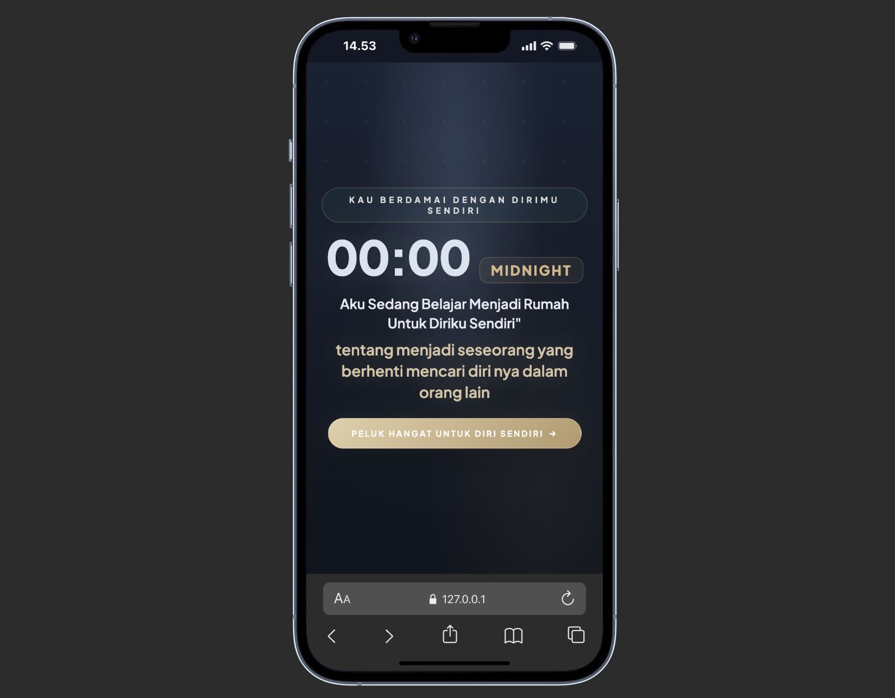

# A Quiet Celebration — Learning to Be Enough


\


> *A quiet space to celebrate yourself, embrace solitude, and learn that being enough has always been a beautiful thing.*

**A Quiet Celebration** is an interactive web experience about self-acceptance, solitude, gratitude, personal reflection, and making peace with yourself. Through atmospheric visuals, gentle animations, and a series of interactive scenes, this project invites you to slow down and appreciate the person you are becoming.

---

## Preview

\<p align="center">   \ \</p>

---

## About the Project

Not every celebration needs an audience. Sometimes, the most meaningful celebration is the quiet moment when you begin to accept yourself, appreciate how far you have come, and find peace in your own company.

This project transforms that idea into an immersive digital experience with a midnight atmosphere, soft lighting, subtle motion, and reflective messages.

It is designed as a personal journey through eight interactive scenes, from embracing a quiet night to finding gratitude and recognizing your own worth.

## Goals

- Create an immersive and emotionally meaningful website experience.
- Explore the beauty of solitude and self-acceptance.
- Express personal reflection through interactive web design.
- Combine modern frontend technologies with cinematic animation.
- Create a digital space that feels calm, personal, and memorable.

## Features

- **Interactive 8-Scene Experience** — A sequential journey through reflection, gratitude, and self-acceptance.
- **Atmospheric Visual Design** — Midnight colors, ambient lighting, subtle particles, and cinematic compositions.
- **Smooth Animations** — Fluid transitions and motion effects to enhance the storytelling experience.
- **Interactive Elements** — Engaging elements that encourage exploration throughout the scenes.
- **Glassmorphism UI** — Modern translucent interface elements with soft blur and layered depth.
- **Responsive Layout** — Designed to adapt to different screen sizes and devices.
- **Personal Reflection** — A collection of messages about growth, letting go, gratitude, and self-worth.

## Tech Stack

| Technology                                                                   | Definition & Purpose                                                                                                                             |
| ---------------------------------------------------------------------------- | ------------------------------------------------------------------------------------------------------------------------------------------------ |
| [HTML5](https://developer.mozilla.org/en-US/docs/Web/HTML)                   | Provides the structural foundation of the website, including scenes, content, interactive elements, and semantic page components.                |
| [CSS3](https://developer.mozilla.org/en-US/docs/Web/CSS)                     | Controls the visual design, layout, typography, colors, responsive behavior, and atmospheric effects such as gradients, blur, and Glassmorphism. |
| [JavaScript (ES6+)](https://developer.mozilla.org/en-US/docs/Web/JavaScript) | Handles interactive functionality, user actions, scene navigation, dynamic content, and animation logic.                                         |
| [GSAP 3](https://gsap.com/)                                                  | A JavaScript animation library used to create smooth transitions, timeline-based animations, and dynamic visual effects.                         |

## Visual Concept

The visual design is built around the atmosphere of a quiet midnight.

- **Midnight Navy** — Represents solitude, depth, and calm.
- **Soft Moonlight** — Symbolizes clarity, reflection, and hope.
- **Ambient Glow** — Creates a warm contrast against the dark environment.
- **Slow Motion** — Encourages a relaxed and immersive experience.
- **Minimal Typography** — Keeps the focus on emotions and meaningful messages.

## Journey Through the Scenes

| Scene | Theme                                                        |
| ----- | ------------------------------------------------------------ |
| 01    | The Quiet Night — embracing solitude                         |
| 02    | A Gift to Myself — appreciating who you are                  |
| 03    | Letting Go — releasing what no longer belongs                |
| 04    | Still Here — honoring your journey                           |
| 05    | One Little Wish — keeping hope alive                         |
| 06    | Things I Am Grateful For — appreciating life's small moments |
| 07    | Letters to Myself — giving yourself kind words               |
| 08    | I Am Enough — finding peace within yourself                  |

## Project Structure

```text
A-Quiet-Celebration/
│
├── index.html
├── script.js
├── style.css
│
└── doc/
    └── ss1.png
```

## Getting Started

### 1. Clone the repository

```bash
git clone https://github.com/your-username/a-quiet-celebration.git
```

### 2. Navigate to the project directory

```bash
cd a-quiet-celebration
```

### 3. Run the project

Open `index.html` directly in your browser, or use the **Live Server** extension in Visual Studio Code for a local development environment.

No Node.js installation or build process is required for the basic static website.

## Purpose & Meaning

**A Quiet Celebration** is a reminder that personal growth does not always have to be loud, that solitude is not necessarily loneliness, and that you do not need to become someone else to deserve appreciation.

Sometimes, all you need is a quiet moment to recognize:

- You have survived difficult days.
- You are allowed to let go.
- Small things are still worth appreciating.
- You do not need to have everything figured out.
- You are already worthy, even while you are still growing.

## Credits

**Created by Revaldi Ermansyah**

Designed and developed as a personal interactive web project exploring solitude, gratitude, and self-acceptance.

Inspired by interactive storytelling, cinematic web experiences, and creative frontend animation.

## License

This project is intended for personal learning, creative exploration, and portfolio purposes.

If you use or modify this project, please consider providing proper credit to the original inspiration and contributors.

---

\<p align="center">
&#x20; \<i>"You don't have to shine for everyone. Sometimes, being at peace is enough."\</i>
\</p>

\<p align="center">
&#x20; Made with patience, creativity, and a little kindness toward myself.
\</p>
